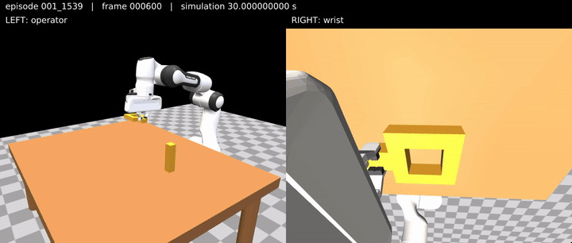
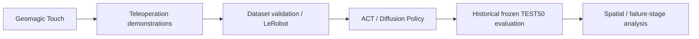
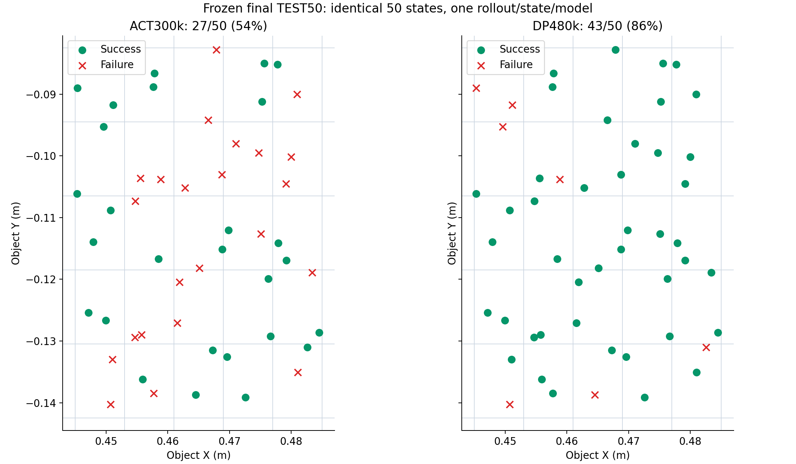

# Franka Imitation Learning

Geomagic Touch demonstration collection, MuJoCo Franka FR3 manipulation, LeRobot dataset conversion, ACT / Diffusion Policy training wrappers, and fixed-protocol policy evaluation.

**Public v1:** an executable / research-artifact release within the [documented reproducibility limits](REPRODUCIBILITY.md). This project connects ordinary Touch demonstration collection to dataset validation, training interfaces, and spatial / failure-stage analysis for Square manipulation. The reported terminal checkpoints achieved **ACT 54% / Diffusion Policy 86%** on the same frozen TEST50.

**Companion teleoperation system:** [franka-teleoperation](https://github.com/jack2148/franka-teleoperation).

## Demonstration Collection



Recorded simulator views from a demonstration collected with **physical Geomagic Touch input controlling a MuJoCo-simulated Franka FR3**. Operator view is on the left and wrist view on the right; the physical device and user are not shown. Input provenance comes from the collection metadata.

This 12-second excerpt belongs to the historical `square_geomagic_xy50_v1` training collection: **50 demonstrations / 48,272 frames**. It is a **training demonstration, not a TEST50 policy rollout**. Playback follows saved simulation sampling, not measured human wall-clock timing.

[MP4 version](assets/media/geomagic_touch_square_collection.mp4) · [Media provenance and checksums](assets/media/README.md)

## Pipeline and Project Contributions



The project contribution is the integration and evaluation workflow:

- Demonstration collection, recording, validation, and LeRobot conversion with explicit observation/action alignment.
- ACT and Diffusion Policy training interfaces, saved configurations, and fixed initial-condition evaluation evidence.
- Per-state result aggregation, spatial success and failure-stage analysis, and dataset/checkpoint provenance.

MuJoCo, LeRobot, and the policy implementations are upstream work; see [third-party provenance](THIRD_PARTY.md). The diagram describes the completed research workflow. The public generic evaluator does **not** include the historical frozen TEST50 campaign launcher.

## Main Square Result

| Policy | Terminal training step | Same frozen TEST50 |
| --- | ---: | ---: |
| ACT | 300,000 | **27 / 50 = 54%** |
| Diffusion Policy | 480,000 | **43 / 50 = 86%** |

These are observations for the specified checkpoints and configurations under this fixed protocol, not algorithm-wide superiority. The policies share **50 paired initial states**; their architectures and training setups differ. Development evaluation is separate from TEST50; TEST50 is not a checkpoint-selection or tuning set.


[ACT per-state evidence](results/square_test50/act300k_per_state.csv) · [DP per-state evidence](results/square_test50/dp480k_per_state.csv) · [Saved training configurations](configs/square/)

## Spatial and Failure-Stage Analysis

The shared initial-position map shows which states each policy completed. There are only two states per workspace cell, so cell-level rates are descriptive.



[Failure-stage comparison](results/square_test50/figures/11_test50_failure_stage_comparison.png) · [Stage counts](results/square_test50/tables/failure_stage_summary.csv) · [Detailed result tables](results/square_test50/tables/)

Stage labels summarize observed progress; they do not establish failure causes. The acquisition diagnostic uses sustained lift/proximity, not measured finger contact, and does not alter the task success criterion.

## Dataset and Evaluation Protocol

| Historical main dataset | Contract |
| --- | --- |
| Identity | `square_geomagic_xy50_v1` → `square_geomagic_xy50_v1_convert` |
| Demonstrations / frames | 50 / 48,272 |
| Sampling | 20 Hz; observation before action |
| Images | Operator + wrist RGB, 640×480 each |
| State | 16D: joint positions, joint velocities, two finger positions |
| Action | 8D: seven absolute joint targets + native gripper command |

This dataset and the main results are separate from the later 50,822-frame MP4 collection. Public v1 preserves numeric 1/2/3 collection annotations without turning them into training weights.

TEST50 uses a frozen 5×5 grid with two initial states per cell, shared state order and inference seeds, and fixed object yaw. Evaluation uses 1,000 Hz physics, 20 Hz policy control, a maximum of 2,400 actions / 120 simulated seconds, and the implemented Square geometric success predicate. See the [full protocol and limitations](REPRODUCIBILITY.md), [dataset identity](results/square_test50/DATASET_IDENTITY.json), and [terminal artifact hashes](results/square_test50/ARTIFACT_MANIFEST.json).

## Repository Structure

```text
environments/mimicgen_square/   Square task and asset provenance
runtime/, dataset/             Collection, recording, validation, conversion
ui/experiment_console/         Ordinary Touch collection and experiment UI
scripts/training/              ACT / Diffusion Policy wrappers
scripts/evaluation/            Generic policy evaluation entry points
scripts/analysis/              Published result aggregation
configs/square/                Saved ACT300k / DP480k configurations
results/square_test50/          Per-state evidence, tables, figures, identities
evidence/, provenance/, tests/  Historical records, source cutoff, CPU contracts
assets/media/                  Training-demonstration preview and attribution
```

See [Public v1 scope](docs/PUBLIC_V1_SCOPE.md) for dependency boundaries and excluded extensions.

## Reproduce Published Tables and Figures

From the checkout root, in the installed Python environment:

```sh
python -m scripts.analysis.regenerate_test50 --output /tmp/square-test50-report
```

Use a new output directory. This aggregates the published per-state CSVs into totals, spatial groups, stage counts, and a comparison figure. It needs no GPU, dataset payload, or model and runs no policy inference. It does not reclassify raw trajectories or rerun TEST50.

## Installation

Follow [INSTALL.md](INSTALL.md) for the paired repository layout, pinned dependencies, CPU tests, and frontend build. Interactive Touch collection additionally requires the physical device, OpenHaptics SDK/runtime, and a display. Training and policy execution require the external data/models and suitable compute.

The installation document's historical OMY asset discussion concerns reference launchers, not a requirement to reconstruct OMY for the Square / ordinary Touch workflow.

## Reproducibility and Limitations

- Exact historical TRAIN source reconstruction is incomplete; exact retraining reproduction is not claimed.
- Full datasets, terminal models, optimizer/RNG states, and trajectory logs remain external, without public download URLs supplied here.
- The historical frozen TEST50 campaign launcher is not provided. The generic seed-reset evaluator is not a rerun of that campaign.
- CPU contracts, frontend build, control-equivalence checks, and result regeneration have been validated within the documented environment. Fresh-OS installation, physical Franka deployment, physical haptic acceptance, and end-to-end real-time performance are not certified by those checks.

Details and source-cutoff evidence are in [REPRODUCIBILITY.md](REPRODUCIBILITY.md). Later workspace controller and experiment changes are outside this frozen release.

## Companion Teleoperation Repository

[franka-teleoperation](https://github.com/jack2148/franka-teleoperation) is a **source/reference release**: current Geomagic Touch software and validation evidence are distinguished from historical OMY-L100 source. It does not provide a ready-to-run reconstruction of the original OMY environment or claim physical Franka deployment.

## Third-Party and Provenance

[THIRD_PARTY.md](THIRD_PARTY.md) records upstream code, assets, and notices. Square is a local FR3 integration, not an exact MimicGen benchmark reproduction. [Export provenance](results/square_test50/EXPORT_MANIFEST.json) distinguishes original evidence from public derivatives; [media attribution](assets/media/README.md) documents the demonstration excerpt separately from evaluation results.
