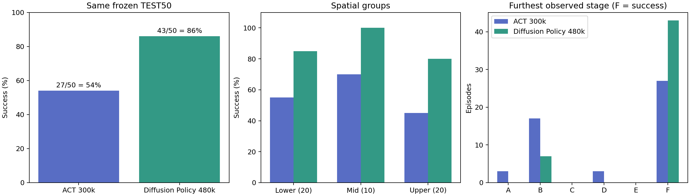

# Franka imitation learning — public v1 candidate

Geomagic Touch demonstration collection, MuJoCo FR3 Square simulation, LeRobot conversion, ACT / Diffusion Policy wrappers, and analysis of a fixed final evaluation.

**Candidate status:** local CPU / frontend validation only; no GitHub release has been made. The paired teleoperation repository still has an OMY scene dependency blocker. See [installation and limits](INSTALL.md).

| Completed Square result | Training step | Same frozen TEST50 |
| --- | ---: | ---: |
| ACT | 300,000 | 27 / 50 = 54% |
| Diffusion Policy | 480,000 | 43 / 50 = 86% |

These are results of these two checkpoints under this fixed protocol, not algorithm-wide superiority. There are 50 paired initial states, not 100 independent states. Both policies use operator + wrist images at **640×480**, 20 Hz observations and 8D absolute joint/gripper actions. The historical training dataset contains 50 demonstrations / 48,272 frames; it is distinct from later MP4 experiments.



- [Protocol, dataset / checkpoint identities and reproduction limits](REPRODUCIBILITY.md)
- [Install, tests and launch](INSTALL.md)
- [Public v1 scope and excluded extensions](docs/PUBLIC_V1_SCOPE.md)
- [Third-party provenance](THIRD_PARTY.md)
- [Per-state ACT evidence](results/square_test50/act300k_per_state.csv), [DP evidence](results/square_test50/dp480k_per_state.csv)

Public v1 retains the ordinary Touch collector, recording / validation, conversion, baseline trainers, evaluation modules and result analysis. Numeric 1/2/3 annotations are recorded and converted without assigning training weights. Unreleased controller, task and weighting extensions are outside this release.

Rebuild the table and figure without a GPU, dataset or model:

```sh
python -m scripts.analysis.regenerate_test50 --output /tmp/square-test50-report
```

The output directory must be new. Historical figures and source CSVs remain unchanged. Full datasets, models, optimizer/RNG states and trajectory logs are external. They do not have public download URLs yet. Exact historical training source reconstruction is incomplete; this tree is not advertised as an exact retraining reproduction.
